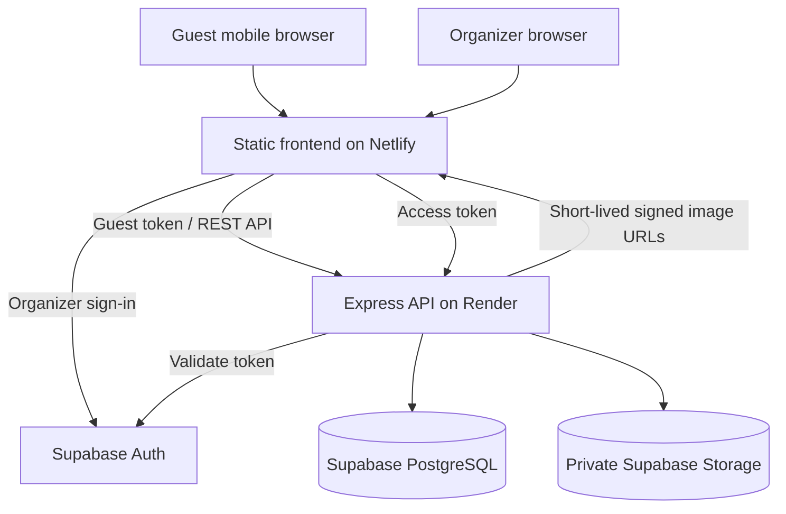

# blurrr architecture

The browser holds only the Supabase public anon/publishable key. The service-role key exists only in the Render environment. Because server-side service-role requests bypass RLS, the API must enforce organizer ownership and guest-token checks for every protected operation.
